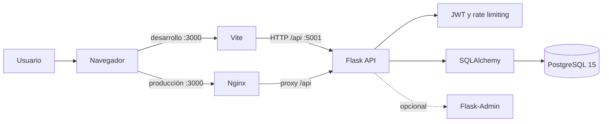
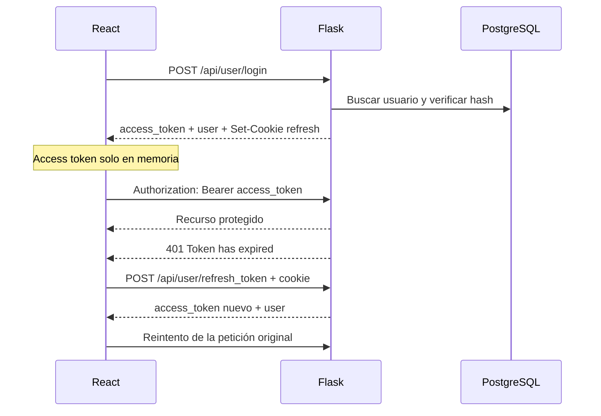
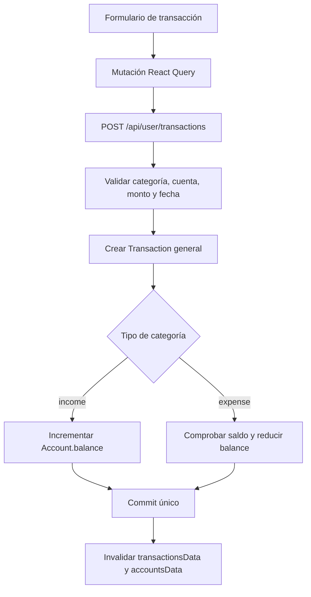
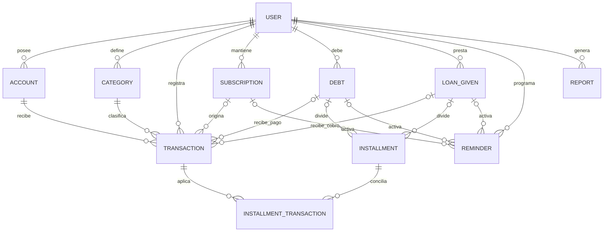

# Arquitectura de FinZen

## Visión general

FinZen es un monorepositorio sencillo con un SPA React, una API Flask y PostgreSQL. El frontend mantiene la sesión visible y el estado remoto; el backend aplica autenticación, reglas financieras y persistencia.

En desarrollo, Vite y Flask se publican en puertos distintos y CORS permite los orígenes configurados. En la imagen de producción, Nginx sirve `frontend/dist` y reenvía `/api/` al contenedor backend.

## Capas y responsabilidades

### Frontend

- `main.tsx` monta `QueryClientProvider`, el store de sesión, el tema MUI, i18n y React Router.
- `routes.tsx` define las rutas públicas y privadas. `ProtectedRoute` y `PublicRoute` esperan a que termine la restauración de sesión.
- `Layout.tsx` intenta renovar el access token al iniciar, actualiza el store y renderiza navegación más contenido anidado.
- `api/axiosInstance.ts` fija la URL base, envía cookies, adjunta el access token y reintenta una petición cuando el backend responde exactamente `401` con `Token has expired`.
- Los hooks de TanStack Query encapsulan cuentas, dashboard y transacciones. El store global solo conserva usuario y estado de autenticación.
- Los componentes Material UI renderizan la interfaz y `i18next` resuelve español o inglés según preferencia guardada/navegador.

### Backend

- `app.py` carga `.env`, crea la aplicación, configura logs, SQLAlchemy/Alembic, JWT, CORS, admin, comandos, blueprints y rate limiting.
- `routes/` valida HTTP y coordina consultas/mutaciones. Todas las rutas financieras actuales requieren JWT.
- `models.py` contiene entidades, enums, relaciones, serialización y parte de las reglas de integridad.
- `commands.py` registra utilidades CLI y seeds heredados; no forman parte del contrato HTTP.
- `admin.py` registra todos los modelos cuando `ENABLE_ADMIN=true` y protege las vistas mediante Basic Auth.

El proyecto no usa todavía una capa separada de servicios o repositorios. Por ello las rutas contienen reglas, consultas y transacciones; cualquier extracción futura debe conservar los contratos descritos en [API](API.md).

## Flujo de autenticación

- El access token dura 15 minutos y se guarda en `window.__ACCESS_TOKEN__`; se pierde al recargar.
- El refresh token dura 6 horas o 30 días según `rememberMe` y se envía como cookie.
- Al cargar la aplicación se llama directamente al endpoint de refresh para restaurar la sesión.
- Logout elimina cookies JWT y el cliente limpia memoria/store.
- Flask acepta JWT tanto en cabecera como en cookie, con prioridad práctica en la cabecera para las peticiones normales.

### Protección CSRF

Con `JWT_COOKIE_CSRF_PROTECT=true`, Flask-JWT-Extended emite `csrf_refresh_token`. Axios conserva cookies, lee ese valor y lo envía en `X-CSRF-TOKEN` al renovar la sesión. El flujo fue verificado a través de Nginx: el refresh con encabezado responde `200` y sin él responde `401`. En producción todavía debe probarse sobre HTTPS con `Secure=true`.

## Flujo de datos financieros

Actualmente la mutación frontend no invalida `dashboardData`, por lo que el panel puede conservar datos cacheados después de crear una transacción. La lectura y actualización del balance tampoco bloquean la fila; dos gastos concurrentes pueden evaluar el mismo saldo inicial.

## Modelo de datos

Entidades principales:

| Entidad | Responsabilidad y reglas relevantes |
| --- | --- |
| `User` | Identidad, hash de contraseña, moneda ISO de tres caracteres y relaciones de propiedad. |
| `Account` | Nombre único por usuario, tipo y balance no negativo. |
| `Category` | Nombre único por usuario y tipo `income` o `expense`. |
| `Transaction` | Monto, fecha, categoría y cuenta; puede vincularse como máximo con suscripción, deuda o préstamo. |
| `Subscription` | Precio, frecuencia, fechas y estado activo. |
| `Debt` / `LoanGiven` | Principal, saldo restante, fechas, estado, cuotas y transacciones. |
| `Installment` | Cuota que pertenece a una deuda o a un préstamo, pero no a ambos. |
| `InstallmentTransaction` | Distribuye un pago entre una cuota y una transacción. |
| `Reminder` | Recordatorio asociado a exactamente uno de los tres tipos soportados según la validación de dominio. |
| `Report` | Resumen JSON por periodo y periodicidad. |

Los importes se almacenan como `Numeric(10, 2)` y se serializan como strings. Las fechas se crean con UTC; los endpoints que reciben `YYYY-MM-DD` las convierten a medianoche UTC.

## Reglas de transacción

- `general`: no puede apuntar a suscripción, deuda o préstamo.
- `subscription`: requiere `subscription_id` y una categoría de gasto.
- `debt_payment`: requiere `debt_id` y una categoría de gasto.
- `loan_payment`: requiere `loan_given_id` y una categoría de ingreso.
- Una transacción no puede vincularse a más de una de esas entidades.
- La API pública actual solo crea transacciones `general`; los demás tipos existen en el dominio y las migraciones.

## Dashboard y recomendaciones

El dashboard agrega balances de cuentas y transacciones del usuario. Usa `date_trunc('month', ...)`, por lo que depende de PostgreSQL aunque `app.py` tenga un fallback SQLite.

El bloque `ai_recommendations` no invoca un modelo de IA. Es un motor determinista que compara ingresos, gastos, ahorro, suscripciones y concentración por categoría, acumula un puntaje de riesgo y clasifica el resultado como `healthy`, `warning` o `critical`. El frontend traduce mensajes conocidos mediante patrones en lugar de recibir claves estables.

## Configuración e infraestructura

- Desarrollo Docker: PostgreSQL `5432`, Flask `5001`, Vite `3000`, bind mounts y recarga Flask/Vite.
- Producción local: PostgreSQL interno, Gunicorn/Flask `5000`, Nginx no privilegiado `8080` publicado como `3000` y proxy same-origin.
- `migrate` espera a PostgreSQL, aplica Alembic una vez y debe terminar antes de iniciar el backend.
- Desarrollo: `compose.override.yaml` agrega bind mounts, Vite, `flask run` y puertos de diagnóstico.
- Logs backend: consola y archivo rotativo `logs/app.log`.
- Migraciones: una cadena Alembic lineal desde la revisión inicial hasta los índices de optimización.
- Rate limiting: memoria del proceso; no es adecuado para múltiples workers o réplicas.

Consulta [Desarrollo y despliegue](DEVELOPMENT.md) para comandos y [Estado del proyecto](PROJECT_STATUS.md) para limitaciones verificadas.
